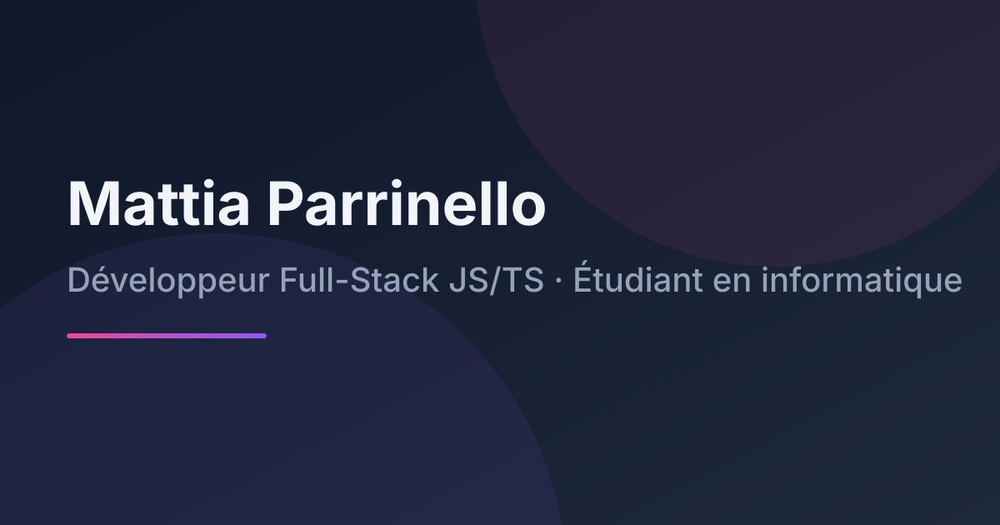
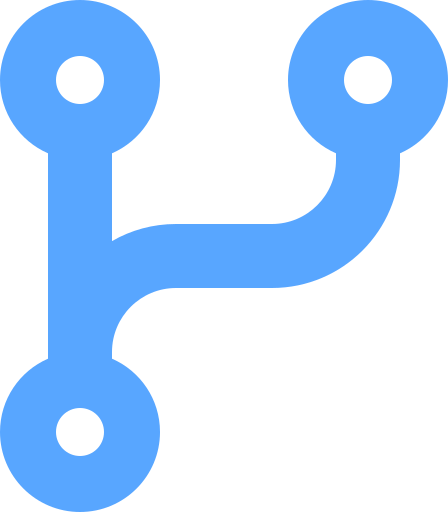
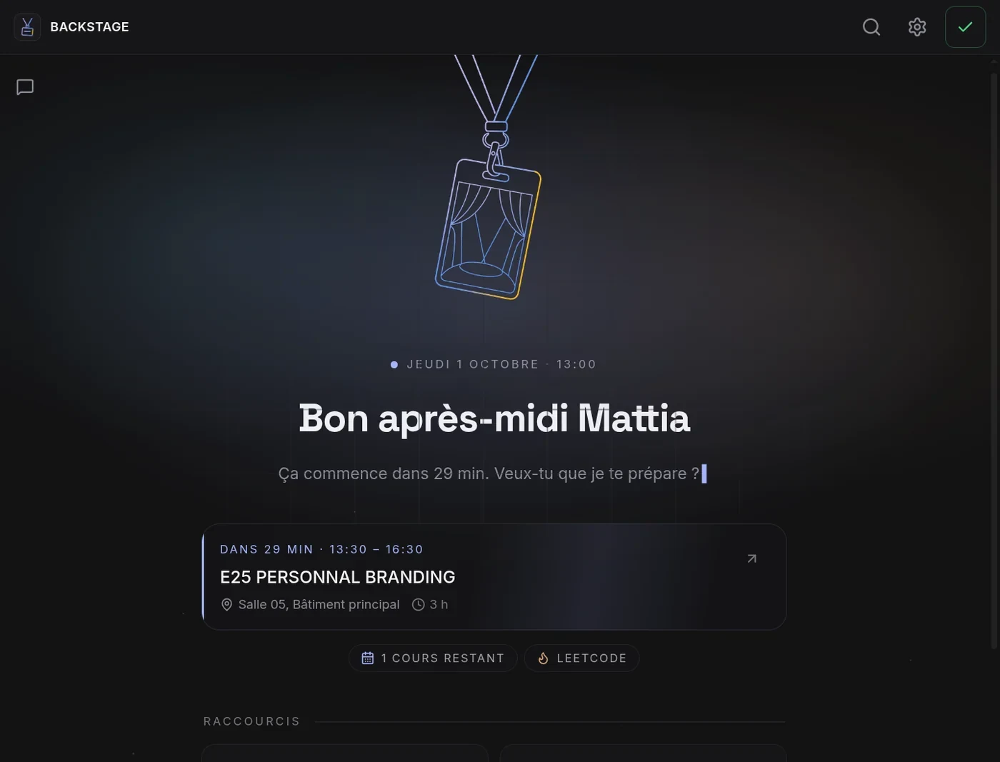
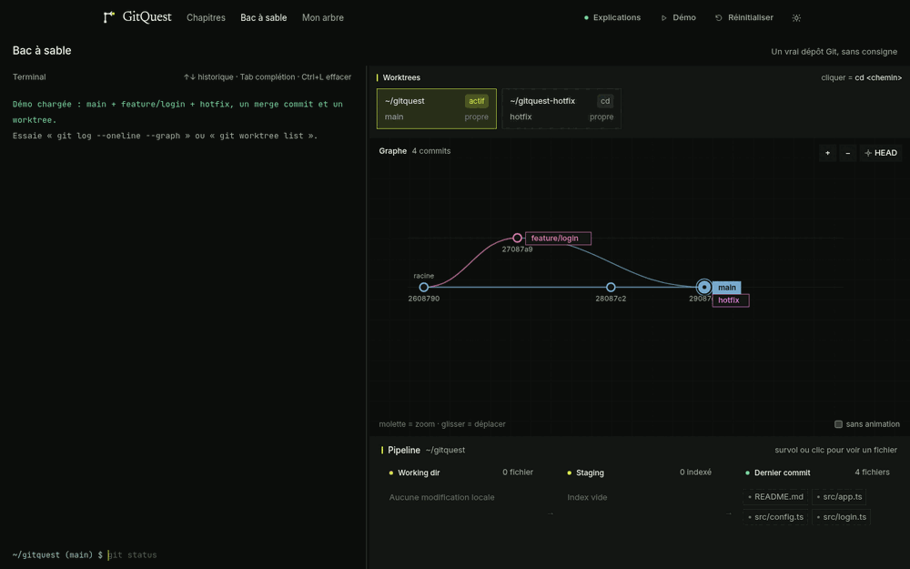
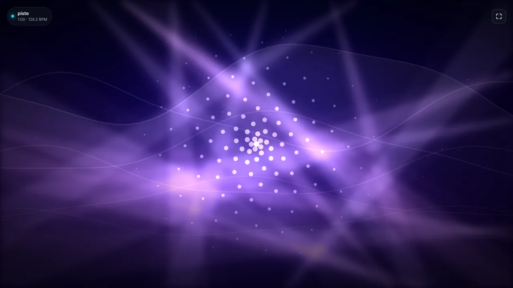
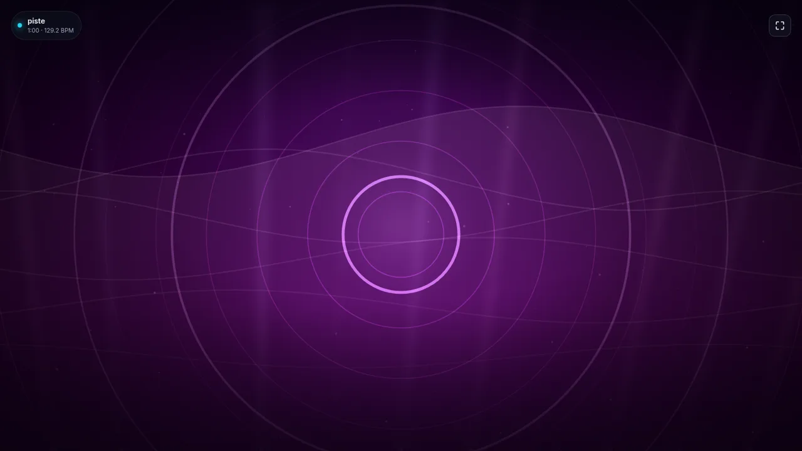
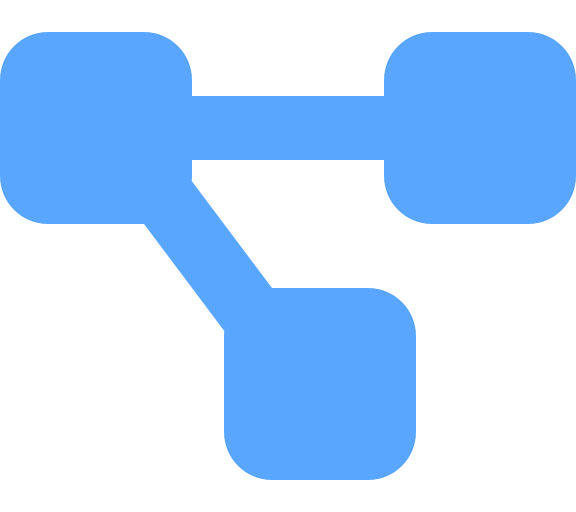

# Mattia Parrinello

### Développeur full-stack JS/TS · Étudiant en informatique

*Je conçois des applications web qui tournent en production, du serveur à l'interface.*

---

##  À propos

Étudiant en 2ᵉ année de **Bachelor Informatique à Sup de Vinci**, je construis des applications web full-stack en **TypeScript** (Next.js, React, Node.js), du schéma de données jusqu'à l'interface.

**Recherche une alternance dès septembre 2027** : rythme 2 sem. entreprise / 2 sem. école · Île-de-France · anglais B2 (First Certificate in English).

Ce que je cherche à montrer ici n'est pas une collection de démos : trois applications réelles, avec des tests, une CI et une mise en production. Ce cycle complet (concevoir, coder, tester, livrer), je veux le poursuivre en entreprise.

| | | | |
|:---:|:---:|:---:|:---:|
| **3** applications livrées | **~32 000** lignes en production | **46** fichiers de tests | **PWA** installables |

- **Sécurité par défaut** : passkeys, JWT courts, OAuth Google, validation systématique des entrées
- **Tester est un garde-fou** : Vitest, Playwright, Jest, pas une formalité
- **Livrer, pas seulement coder** : variables d'environnement, migrations, monitoring, rollbacks

---

##  Stack

---

##  Projets

### BACKSTAGE : second cerveau IA

PWA installable, déployée en production sur **[brain.mprnl.fr](https://brain.mprnl.fr)** : passkey + streaming SSE + OAuth :

- Chat IA à **mémoire persistante** : chaque fait est éditable, chaque relation visible, rien n'est une boîte noire
- Rappels synchronisés Microsoft To Do, agenda, notifications push, lecture d'e-mails
- 34 routes API, 20 Server Actions, ~32 000 lignes, 46 fichiers de tests

**[Dépôt](https://github.com/MattiaPARRINELLO/backstage)** · **[Voir en ligne](https://brain.mprnl.fr)**

---

### GitQuest : apprendre Git par la pratique

Jeu gratuit, dans le navigateur ou sur Android, où chaque commande Git tape dessine le graphe.

- **6 chapitres, 19 missions** : branche, commit, merge, conflit, remote, push, pull
- Vrai moteur Git côté client : ce n'est pas un quiz, c'est un dépôt qui réagit
- PWA hors-ligne, APK Android signé, CI (typecheck, tests, build, smoke test)

**[Jouer](https://mattiaparrinello.github.io/git-quest/)** · **[Dépôt](https://github.com/MattiaPARRINELLO/git-quest)**

---

### Night Light : spectacle lumineux synchronisé sur la musique

Tu déposes un morceau, le serveur l'analyse, le navigateur joue un show lumineux calé sur le temps musical.

- Analyse audio en **Python (librosa)** : bandes, tempo, temps forts, énergie, montées
- Rendu **Canvas 2D** piloté par `audio.currentTime`, pas un visualiseur qui réagit au volume
- Après une pause ou un retour en arrière, le spectacle reprend exactement là où la musique en est

**[Dépôt](https://github.com/MattiaPARRINELLO/night-light-v2)**

---

##  Autres projets

**Portfolio développeur** : [dev.mprnl.fr](https://dev.mprnl.fr) : stats GitHub temps réel, micro-interactions, direction artistique maison.

**Portfolio photo** : [photo.mprnl.fr](https://photo.mprnl.fr) : galeries entièrement personnalisables via une interface d'administration (Next.js, stockage local, déploiement continu).

**Autologin** : extension Chrome qui automatise le pointage CESAR Emineo, utilisée par des élèves de mon école.

**Stellaris** : API de réservation de rendez-vous avec authentification par clé, tests et documentation.

**Gymshark-Sync** : assistant interne sur LLM local (Node.js/Express + Ollama : synthèses, planification, historique ; tests Jest, doc Swagger) · [github.com/mattia-school/gymshark-sync](https://github.com/mattia-school/gymshark-sync)

---

##  Photographie

**Photographe de concert** pour des médias (Jok'air, Damso, Arma Jackson, Romsii…) : couverture de concerts, sélection et retouche des images en autonomie, dans des délais de publication serrés.

**[Voir le portfolio](https://photo.mprnl.fr)** · **[@mattia_jpeg sur Instagram](https://instagram.com/mattia_jpeg)**

---

##  Expérience

**Stagiaire développeur, INOVSHOP Group, Paris (2022 – 2023)**

- Planification et affichage des jours de télétravail sur **écrans e-ink** (API e-ink, Node.js)
- Application web d'affichage en temps réel de l'occupation des salles (HTML/CSS/JS, serveur Node.js)

---

##  Me retrouver

| | |
|:---|:---|
| **Email** | [contact.mprnl@gmail.com](mailto:contact.mprnl@gmail.com) |
| **Portfolio** | [dev.mprnl.fr](https://dev.mprnl.fr) |
| **Photos** | [photo.mprnl.fr](https://photo.mprnl.fr) |
| **LinkedIn** | [Mattia Parrinello](https://www.linkedin.com/in/mattia-parrinello-015382208/) |
| **GitHub** | [@MattiaPARRINELLO](https://github.com/MattiaPARRINELLO) |

---

*« Un bon site, c'est comme une bonne photo : si tu remarques la technique avant le contenu, c'est raté. »*

