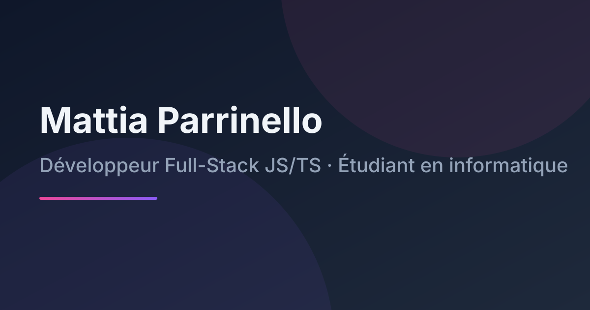
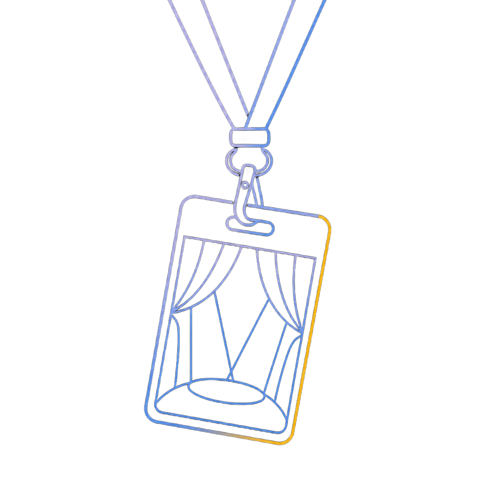
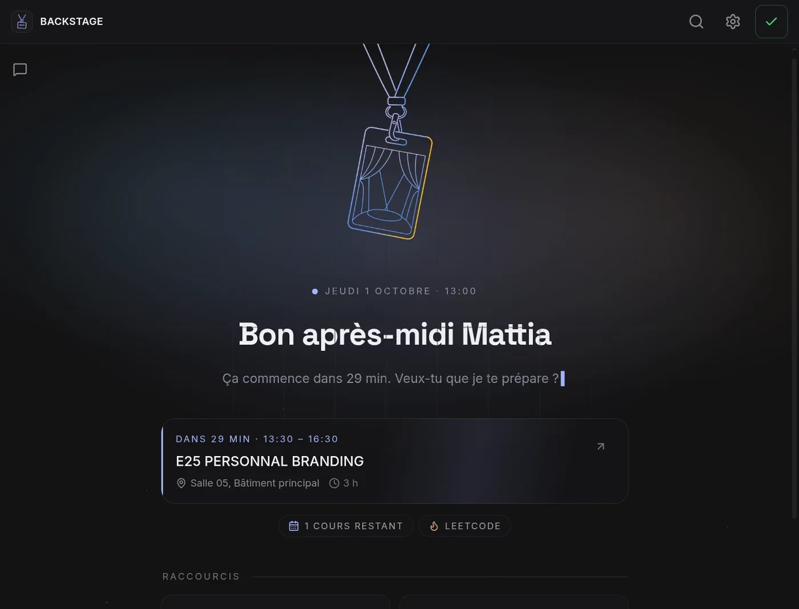
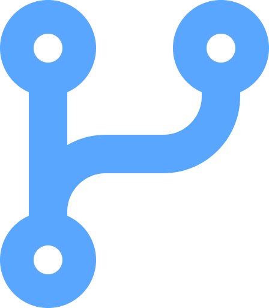
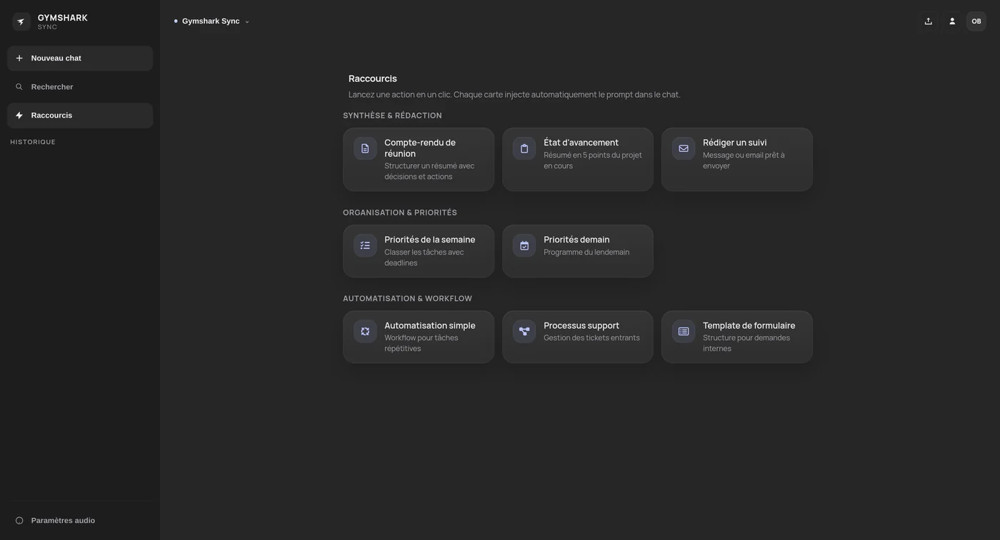

# Mattia Parrinello

### Développeur full-stack JS/TS · Étudiant en informatique

*Je conçois des applications web qui tournent en production, du serveur à l'interface.*

---

##  À propos

Étudiant en 2ᵉ année de **Bachelor Informatique à Sup de Vinci**, je construis des applications web full-stack en JavaScript, avec TypeScript et React en cours d'apprentissage.

**BACKSTAGE** est une PWA déployée en production que j'utilise tous les jours, avec une vraie suite de tests. C'est ce cycle complet — concevoir, coder, tester, livrer — que je veux poursuivre en entreprise.

| | |
|:---:|:---:|
| **~32 000** lignes en production | **46** fichiers de tests |
| **1** produit utilisé tous les jours | **1** alternance cherchée : sept. 2027 |

- **Sécurité par défaut** — passkeys, JWT courts, OAuth Google, validation systématique des entrées
- **Tester est un garde-fou** — Vitest, Playwright, Jest, pas une formalité
- **Livrer, pas seulement coder** — variables d'environnement, migrations, monitoring, rollbacks

---

##  Stack

---

##  Projet phare — BACKSTAGE, second cerveau IA

PWA installable, déployée en production sur **[brain.mprnl.fr](https://brain.mprnl.fr)** — passkey + streaming + OAuth :

- Chat IA à **mémoire persistante** : chaque fait est éditable, chaque relation visible, rien n'est une boîte noire
- Rappels synchronisés Microsoft To Do, agenda, notifications push, lecture d'e-mails
- 34 routes API, 20 Server Actions, ~32 000 lignes, 46 fichiers de tests

**[Dépôt GitHub](https://github.com/MattiaPARRINELLO/backstage)** · **[Voir le projet](https://brain.mprnl.fr)**

---

##  Autres projets

**Gymshark-Sync** — assistant interne sur LLM local (serveur Node.js/Express + Ollama : synthèses, planification, historique ; tests Jest, doc Swagger) · [github.com/mattia-school/gymshark-sync](https://github.com/mattia-school/gymshark-sync)

**Portfolio développeur** — [dev.mprnl.fr](https://dev.mprnl.fr) — stats GitHub temps réel, micro-interactions.

---

##  Photographie

**Photographe de concert** pour des médias (Jok'air, Damso, Arma Jackson, Romsii…) : couverture de concerts, sélection et retouche des images en autonomie, dans des délais de publication serrés.

Le site [photo.mprnl.fr](https://photo.mprnl.fr), conçu de A à Z, rend le portfolio photo entièrement personnalisable via une interface admin — galeries, langue, affichage.

**[Voir le portfolio](https://photo.mprnl.fr)** · **[@mattia_jpeg sur Instagram](https://instagram.com/mattia_jpeg)**

---

##  Expérience

**Stagiaire développeur — INOVSHOP Group, Paris (2022 – 2023)**

- Planification et affichage des jours de télétravail sur **écrans e-ink** (API e-ink, Node.js)
- Application web d'affichage en temps réel de l'occupation des salles (HTML/CSS/JS, serveur Node.js)

---

##  Disponible pour une alternance

Dès **septembre 2027** · rythme **2 sem. entreprise / 2 sem. école** · Île-de-France · anglais **B2** (First Certificate in English)

---

##  Me retrouver

| | |
|:---|:---|
| **Email** | [contact.mprnl@gmail.com](mailto:contact.mprnl@gmail.com) |
| **Portfolio** | [dev.mprnl.fr](https://dev.mprnl.fr) |
| **Photos** | [photo.mprnl.fr](https://photo.mprnl.fr) |
| **LinkedIn** | [Mattia Parrinello](https://www.linkedin.com/in/mattia-parrinello-015382208/) |
| **GitHub** | [@MattiaPARRINELLO](https://github.com/MattiaPARRINELLO) |

---

*« Un bon site, c'est comme une bonne photo : si tu remarques la technique avant le contenu, c'est raté. »*

